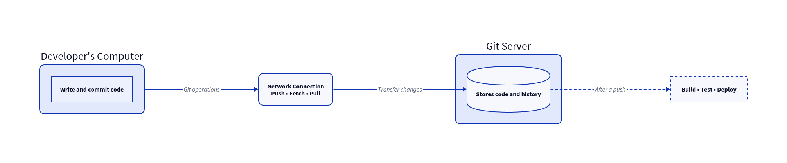
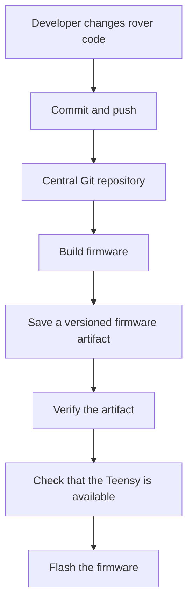

# Setting up a Git server for the Rover

Git is commonly used in services such as GitHub or GitLab, as a convenience to have a centre for code access. This central place that stores all of the code doesn't usually have to be a third-party service, it could be one of your old laptops, a machine in a lab, or one of the devices in your inventory.

This is the idea of self-hosting a Git server. The familiar workflow of Git is preserved, while we build on top of it. 

### Why did we explore this option for the rover?
We wanted a reliable way to push code from one of the developer's machines over to the OptiPlex mounted on the rover, and eventually connect code updates to firmware deployment—that is, triggering a build for the Teensy. 

## The first draft of this idea

If we look at Git as a tool to keep track of the project up to the present, a Git server could be the place that makes a shared copy of all the history available to other computers or systems.

Hence, we would take Git, a version control system, and host it, using the same infrastructure for our purpose. 

## Architecture

At a high level, we'd need this server to:
1. Store the repository
2. Accept connections - allow other devices to connect to the repository, given appropriate access controls.
3. Respond to updates - give back a response to any action performed with the server's involvement.

**The developer's laptop and the server can be on the same local network, connected through a private network or connected through an RF link. This may affect part of the workflow, but not the central idea.

## 1. The host

For the rover specifically, we have an OptiPlex mounted on it. This would be the host for the repositories, and this is the central place to push or retrieve code.

But, if there is a requirement for general purpose hosting devices, a few things to consider are:
- Availability of the device while accessing the repository.
- Storage and backups
- Permissions to read, write, or have admin privileges.
- Privacy, if the repo contains sensitive or that must be hidden from public access.

## 2. How does a developer's system connect to the server

There are two common ways to connect to the server:
- **SSH** is common for developer-oriented setups. Access could be controlled through user accounts and SSH keys.
- **HTTP(S)** is used when the Git traffic needs to be controlled through a Web Server or when the web-based infrastructure needs to be integrated with the application.

Here, we explored Git's Smart HTTP mechanism. The important architectural idea is that Git requests arrive through a network-facing service, which passes them to Git's backend so the repository can handle operations such as pushing and fetching. A web server such as Nginx can be placed before the backend.

## 3. What happens when someone pushes code?

A few processes can kick into action when there is a `git push`.
1. The developer's Git client connects to the server.
2. The server checks whether the requested operation is allowed.
3. Git transfers the required objects and updates the relevant branch reference.
4. The central repository now records the new revision.
5. If configured, a server-side hook can run a follow-up task.

A hook is a script that Git runs at a particular point in an operation. So, there is a `post-receive` hook that is configured to start processes after a push has been received. 

But, the end goal is to have a successful deployment, not just a successful push sequence.

## 4. How do we put it all together? 

To get back to the final goal, we have to reduce the amount of manual work between changing firmware and getting that firmware onto a Teensy board. The intended workflow connects version control with a build-and-deployment process.

## 5. A few challenges to be wary of

### A network timeout must not be perceived as a broken network.
The actual cause may lie in a downstream process that takes too long to complete.

### The first push must be handled.
There may be no previous commit to compare against. 

### Built files must be versioned
It helps in linking each artifact to its source commit and verifying it using checksums.

### Taking care of access and security restrictions
Ensuring only authorised users and processes can access repositories and deployment resources.

## Building all this

There is some value in assembling a minimal server from Git and a few system services. It essentially helps one understand the workings of repository storage, network access, permissions, hooks, and how they all fit together. 

Now while we've discussed the ground level workings of these, there is a much easier way to achieve the same results using Gitea. Hence, we are setting up one for our own use, in order to achieve abstraction, better user experience and ease of the process. 

What we finally achieved is hosting our own server, choosing how edge devices connect, and extending it with automation when the workflow calls for it. 
If you are interested in the complete technical documentation of this setup, <<link to the repo>>.