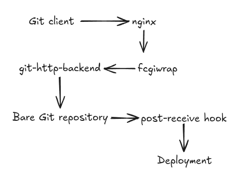

# Building a Self Hosted Git Server for a CI/CD Pipelined Workflow for the Rover

## The Problem at Hand

There was a necessity to automatically push the code and trigger a flash onto Teensy without using any hardware or manually transferring the code and flashing every single time. This automation would prove to be very helpful, especially in times where the rover is at a distance where the communication would happen only through the antenna, with an absence of a WiFi or network connection.

## Solution

One of the solutions that we went forward with was to host a Git server. The logistics of which would be explained below.

### A Base Overview of the Architecture Decided



### 1. Setting Up the Git Server

In the current case, the server machine was the Optiplex mounted on the Rover, where the Git repos are stored under `/srv/git`.

For our trial run, we went ahead with bare repositories. A bare repo contains only the Git database that could act as a central remote. Therefore, it essentially does not contain a normal checked-out working tree.

1. `git init --bare /srv/git/repo_name.git`

Post this, we need a way for a remote Git client to communicate with it.

### 2. Choosing the Right Git Server Protocol

We chose the [Git Smart HTTP Server](https://git-scm.com/book/ms/v2/Git-on-the-Server-The-Protocols) rather than exposing the repo through SSH. Go through the documentation to find what fits your use case best.

This was the `git-http-backend` that would operate in Git's HTTP protocol.

`nginx` was used as the proxy (web) server and `fcgiwrap` would connect nginx to the Git backend, and that in turn to `/srv/git/`.

### Initializing This Architecture

#### 1. `install_packages()`

```bash
apt update
apt install -y git nginx fcgiwrap
```

#### 2. Creating the Git User

We create the git user in the Git directory of the server.

```bash
adduser --system --group --home /srv/git git
```

#### 3. Create the Repo Root and Give All Access Permissions to It

```bash
mkdir -p /srv/git
chown git:git /srv/git
chmod 755 /srv/git
```

#### 4. Configure nginx

```bash
if [ ! -f "$NGINX_CONF" ]; then

    echo "Error: $NGINX_CONF not found."

    exit 1

fi

cp "$NGINX_CONF" /etc/nginx/sites-available/git

ln -sf /etc/nginx/sites-available/git \
       /etc/nginx/sites-enabled/git

nginx -t
```

#### 5. Install the fcgiwrap Service

```bash
cp "$FCGI_SERVICE" /etc/systemd/system/fcgiwrap.service

systemctl daemon-reload
```

#### 6. Verification Checks

We could go ahead and add a verification check for all the above steps once executed, using:

```bash
systemctl is-active --quiet nginx

systemctl is-active --quiet fcgiwrap

if [ -x /usr/lib/git-core/git-http-backend ];
```

### Using the Version Controls on the Demo Repo

Now that we created the repo, we now needed to build a pipeline through which we could push code to the rover.

**Note:** Make sure to enable Git's HTTP receive functionality for this to work.

```bash
git --git-dir=/srv/git/teensy_deployment_test.git \
    config http.receivepack true
```

Now, your commits would go through successfully. But while we push, there must be a deployment backend that would be installed onto the Optiplex.

### 3. What Really Does the Git Hook Receive?

This "hook" receives information of all the references that were updated.

You would ideally aim to receive:

* old revision
* new revision
* reference

e.g.

```text
45fe41c89725... abc123... refs/heads/master
```

This information would be used to determine what changed, and which branch changed.

#### Let's Go Through the Code — All That's Present in the `post-receive` Bash

1. The main objective of the post-receive hook is to look at `oldrev newrev refname`. That is, the Old Revision, New Revision, and the Reference Name.

   We extract all these from the Log (`$LOG`).

2. Checking the changed files

```bash
git --work-tree="$WORK_TREE" \
    --git-dir="$GIT_DIR" \
    checkout -f "$newrev" >> "$LOG" 2>&1

CHANGED_FILES=$(git --git-dir="$GIT_DIR" diff --name-only "$oldrev" "$newrev")
```

3. Accessing the Hex Files

Here, since I need the Teensy to get remotely updated with the code, my penultimate steps would include `pio run`, followed by pushing the `.hex` (Hexadecimal) file over to the server side.

Therefore,

```bash
if [ -n "$HEX_FILES" ]; then

    echo "Firmware HEX changed." >> "$LOG"

    HEX_FILE="$WORK_TREE/$(echo "$HEX_FILES" | head -n 1)"

    if [ ! -f "$HEX_FILE" ]; then

        echo "ERROR: HEX file not found: $HEX_FILE" >> "$LOG"

        exit 1

    fi
```

4. Ultimately, we flash the same hex file onto the Teensy.

   i. Firstly, check if Teensy is being detected.

   `lsusb` — you must see something akin to:

```text
...Teensyduino ...
```

or

```text
Teensy HalfKay Bootloader
```

ii. Then, run:

```bash
/usr/local/bin/teensy_loader_cli \
    --mcu=TEENSY41 \
    -w \
    -v \
    "$HEX_FILE" \
    >> "$LOG" 2>&1
```

#### One Thing to Keep in Mind When Going for the First Push

The hook tries to gauge at the previous commit like a normal Git commit, but since a first push would not have any of that sort, the result would give you:

```text
fatal: bad object 0000000..
```

### 4. Now That We Have the Architecture Ready, Here Are Some Things to Be Wary Of

#### The HTTP 504 Issue

**Error:**

When `git push` reached `Writing objects: 100%`, there would be an `HTTP 504` error.

First, I thought there was a problem with Nginx. But what actually happened was that while we were waiting for Teensy, nginx eventually timed out, hence the 504. That meant that the Teensy was not being detected properly.

#### 4.1. Loader Gave an `Unable to claim interface, check USB permissions` Error

* The USB permissions were not set right. Initially, it said:

```text
crw-rw-r-- 1 root root ..
```

which the git user wasn't able to access properly.

* A solution to this was to create a `/etc/udev/rules.d/00-teensy.rules` with permissions of:

```text
16c0:0483 → plugdev
16c0:0478 → plugdev
```

#### 4.2. Discovering the Second Teensy USB Mode

Normal Teensy would be seen as:

```text
16c0:0483

Teensyduino Serial
```

But the bootloader looks like:

```text
16c0:0478

Teensy HalfKay Bootloader
```

And hence, there had to be another rule for the udev rule for `16c0:0478`, and because HalfKay exposes itself through HID, we needed:

```bash
KERNEL=="hidraw*", ATTRS{idVendor}=="16c0", ATTRS{idProduct}=="0478", MODE="0660", GROUP="plugdev"
```

So this helped me achieve:

```text
crw-rw---- 1 root plugdev ...
```

and most importantly,

```text
READ OK

WRITE OK
```
5. Let's quickly fix the constant copying of the hex file with the updated changes.

We could solve this by treating the compiled firmware as a build artifact. So each artifact would be stored using its Git commit SHA, and the directory tree would look something like this: 

```
/srv/artifacts/
└── teensy_deployment_test/
    └── teensy41/
        └── <git-commit-sha>/
            ├── firmware.hex
            └── metadata

```
The metadata records the relationship between the source revision, target board and binary. 
To be brief, this is what we will follow
```
./deploy.sh
     │
     ├── Build firmware
     │
     ├── publish_firmware.sh
     │      └── Store HEX + SHA-256 by commit SHA
     │
     └── git push rover
              │
              ▼
        post-receive hook
              │
              ├── Find artifact
              ├── Verify SHA-256
              └── Flash Teensy

```
We now could also have ``` publish_firmware.sh ``` that can build the versioned firmware artifact and publish it onto the OptiPlex (Server).
We then add a few checks in the ``` post-receive ``` hook:

```
EXPECTED_SHA=$(grep '^sha256=' "$METADATA_FILE" | cut -d= -f2)
ACTUAL_SHA=$(sha256sum "$HEX_FILE" | awk '{print $1}')

if [ "$EXPECTED_SHA" != "$ACTUAL_SHA" ]; then
    echo "ERROR: SHA-256 verification FAILED."
    exit 1
fi
```


### And with that, we reach the end of a minimally working git server, with a good amount of flaws that we could resolve another time. 

Now that you've hopefully built all this, let me demolish everything you just did, and point you to this: [gitea](https://about.gitea.com/).


