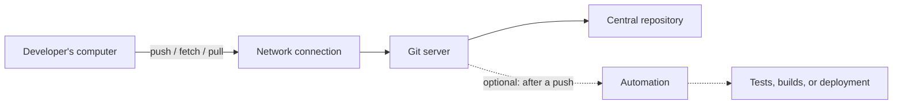
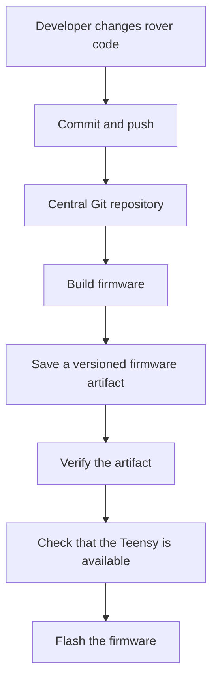

# Your Own Git Server: Turning Any Computer into a Place for Your Code

*What self-hosting Git looks like, how the pieces fit together, and what I learned while building one for a rover project.*

Most of us use Git through a service such as GitHub or GitLab. We make a change, commit it, and push it somewhere central so the rest of the team can access it.

But the central place that stores your code does not have to belong to a third-party service. It can be a computer you own or control: an old desktop, a small home server, a machine in a lab, or an onboard computer in a robotics setup.

That is the idea behind a **self-hosted Git server**. You keep the familiar Git workflow, but you choose where the shared repositories live and how other machines reach them.

I explored this while working on a rover. The immediate motivation was practical: we wanted a reliable way to manage code on a machine associated with the rover, and eventually connect code updates to firmware deployment. The useful part, though, is not specific to robotics. The same basic architecture can be adapted to a personal server, a lab machine, or a small team's internal network.

## First, what are we actually building?

Think of Git as the tool that records the history of a project, and a Git server as the place that makes a shared copy of that history available to other computers.

A developer works on their own machine. When they push changes, those changes travel to a central repository. Other developers can then fetch or pull them. The server does not need to be the computer where everyone writes code; its job is to make the shared repository reachable and consistent.

A useful distinction: **Git is the version-control system; a Git hosting service is the software and infrastructure around it.** You can host Git repositories without building a full web interface, user dashboard, or project-management system.

## The architecture, without the jargon

At a high level, a self-hosted Git setup has three jobs:

1. **Store the repository.** Keep the project's history and branches in a central location.
2. **Accept connections.** Give other machines a way to communicate with that repository, with appropriate access controls.
3. **Respond to updates.** Optionally run a task after a push—for example, testing code, building a program, or preparing a firmware deployment.

Here is the basic flow:

The developer's computer and the server can be on the same local network, connected through a private network, or linked remotely through a properly secured connection. The choice affects networking and security, but not the central idea.

## 1. Choose the computer that will host your repositories

A Git server does not necessarily need specialised hardware. It can run on a Linux desktop, a virtual machine, a home server, or a computer already doing another job.

For my rover setup, we used an OptiPlex machine associated with the rover's base station. The repositories were stored on that machine, so the team had a central place to push and retrieve code.

Before choosing a host, think about a few practical questions:

- **Availability:** Does the computer stay powered on when people need the repository?
- **Network access:** Can the intended clients reach it from their location?
- **Storage and backups:** Is there enough space, and is the repository history backed up somewhere else?
- **Permissions:** Who should be able to read, push, or administer repositories?
- **Exposure:** Does the server need to be accessible only on a local network, over a private VPN, or from the public internet?

These choices matter more than having a powerful machine. A small server can be perfectly adequate for a team-sized repository, provided it is reachable and maintained.

## 2. Decide how clients will talk to the server

Git needs a way to move repository data between the client and the server. Two common approaches are **SSH** and **HTTP(S)**.

- **SSH** is a common choice for developer-oriented setups. Access is usually controlled through user accounts and SSH keys.
- **HTTP(S)** can fit well when you want Git traffic to pass through a web server or when you need to integrate with web-based infrastructure. HTTPS also provides transport encryption when configured correctly.

Neither protocol is automatically the right answer for every environment. The choice depends on the network, how users authenticate, and how you want to manage access.

In my initial experiment, I explored Git's Smart HTTP mechanism. The important architectural idea is that Git requests arrive through a network-facing service, which passes them to Git's backend so the repository can handle operations such as pushing and fetching. A web server such as Nginx can sit in front of that backend.

That is one possible way to assemble a Git server from smaller pieces. It is not the only way—and it means that you are responsible for configuring and maintaining those pieces yourself.

## 3. Understand what happens when someone pushes code

A `git push` can feel like one action, but several things happen behind the scenes:

1. The developer's Git client connects to the server.
2. The server checks whether the requested operation is allowed.
3. Git transfers the required objects and updates the relevant branch reference.
4. The central repository now records the new revision.
5. If configured, a server-side hook can run a follow-up task.

A **hook** is simply a script that Git runs at a particular point in an operation. A `post-receive` hook, for example, can be used to start work after a push has been received.

That last step is where a plain Git server can become part of a larger workflow. A push could trigger tests, build an application, publish an artifact, or notify another system. But storing code and deploying code are separate responsibilities: a successful push should not be confused with a successful deployment.

## 4. The rover use case: from code changes to firmware

For the rover, the longer-term goal was to reduce the amount of manual work between changing firmware and getting that firmware onto a Teensy board. The intended workflow connects version control with a build-and-deployment process.

This diagram describes the intended workflow, not a claim that every step is already production-ready. The repository is one part of the system; compiling firmware, locating the correct output, checking its integrity, detecting the board, and flashing it are additional steps that need their own handling.

Keeping these responsibilities separate makes the system easier to reason about. If a push succeeds but flashing fails, for example, you want to be able to tell whether the problem was in Git, the build, USB access, or the board itself.

## 5. The challenges that changed how I thought about the setup

The most instructive problems were not about Git commands themselves. They came from connecting several systems that each had their own assumptions.

### A network timeout does not always mean the network is broken

During testing, a push reached the point where all the objects had been written, but the client eventually received an HTTP 504 timeout. At first, that looked like a web-server problem. The deployment path was also waiting for the Teensy, however, and the board was not being detected as expected.

The lesson: when a request triggers a long-running task, the client-facing connection and the task's actual outcome can get tangled together. Logs and clear stage-by-stage status messages help distinguish a transport problem from a build or deployment problem. For a more robust design, the push should finish promptly and longer deployment work should be handled separately, with a way to report its status.

### USB devices can appear differently in different modes

The Teensy did not present itself identically during normal operation and while entering its bootloader. The deployment process therefore had to account for more than one USB device identity, and the server-side user needed appropriate permissions to access it.

This is a broader systems lesson: a device that works for an administrator may still fail for a service running under a restricted account. Permissions should be configured deliberately rather than solving every issue by running the entire process with elevated privileges.

### A first push is a special case

A script that compares the old and new revisions can assume there is a previous revision to compare against. On the first push to a branch, there may not be one. That means automation needs to handle initial setup separately from later updates.

This kind of edge case is easy to miss when a workflow is tested only after the repository already has history.

### Built files deserve their own identity

Firmware is a generated output of source code. If the deployment process repeatedly copies a file with the same name, it can become difficult to know which source revision produced the binary currently being flashed.

A more traceable approach is to store each build as a versioned artifact and associate it with the source commit, target board, and a checksum. The checksum helps verify that the file being deployed is the same file that was published. This does not guarantee that the firmware is correct, but it helps detect accidental corruption or mismatches.

## 6. Security and maintenance are part of the architecture

A server that is reachable is not necessarily a server that is safe to expose. Before allowing a wider audience to use it, consider:

- Restricting who can read and write each repository.
- Using SSH keys or properly configured HTTPS authentication.
- Keeping the operating system and server software updated.
- Limiting network access to the people and machines that need it.
- Backing up repositories and testing that they can be restored.
- Keeping deployment hooks narrowly scoped, logging what they do, and avoiding unnecessary root privileges.
- Separating code storage from privileged actions such as flashing hardware.

If the server is only for a lab or home network, it may not need to be exposed to the public internet at all. A private network or VPN can be a better fit. The right design depends on who needs access and from where.

## 7. Build it yourself, or use a hosting application?

There is value in assembling a minimal server from Git and a few system services. It forces you to understand how repository storage, network access, permissions, and hooks fit together. It can also be useful when you need a deliberately small setup or want to customise the integration with another system.

The trade-off is maintenance. You become responsible for configuration, authentication, access management, backups, monitoring, and troubleshooting. As soon as several people depend on the service, those responsibilities matter as much as getting the first push to work.

For a general-purpose team server, a self-hosted Git hosting application can provide a more convenient layer on top of Git repositories. **We are currently setting up Gitea for our own use**, so it is the direction we are exploring rather than a finished result to present as production-ready. The key takeaway is broader than any one tool: you can host your own Git service on a computer you control, choose how clients connect, and extend it with automation when your workflow calls for it.

---

*The goal of this experiment was not to build a replacement for every hosted Git platform. It was to understand the moving parts, see where the boundaries between them lie, and work toward a workflow that fits the needs of a rover team.*